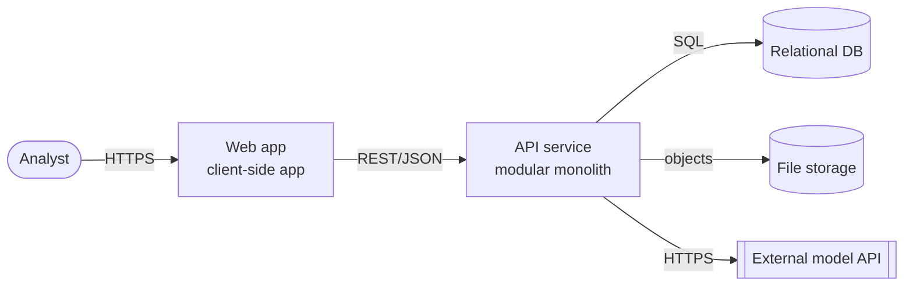

# Diagrams (from Markdown sources)

Goal: diagrams that are correct, small, versioned with the code, and regenerated when the design changes.

## Format
- **Mermaid** in Markdown, rendered by most git hosts and editors. Source of each diagram: `docs/design/diagrams/<name>.mmd`, embedded in the design file in a ```mermaid block (or linked).
- If a richer tool is needed (Structurizr, PlantUML, draw.io), record that choice in a decision record; still keep a text source in the repo.

## Which diagram answers which question

| Question | Diagram | Mermaid type | Built from |
|---|---|---|---|
| What is the system and who uses it? | C4 context | `flowchart` (or `C4Context`) | personas (product/stories.md), interfaces (product/requirements.md) |
| What are the deployable parts and how do they talk? | C4 container | `flowchart` | system-shape, api-style, data-storage decision records |
| What is inside one container? | Component | `flowchart` | architecture.md |
| What happens step by step in a key flow? | Sequence | `sequenceDiagram` | a story + api.md |
| What data exists and how is it related? | Data model | `erDiagram` | data-model.md |
| What states can a record be in? | State | `stateDiagram-v2` | requirements, data-model.md |
| Where does it run? | Deployment | `flowchart` | deployment decision record |
| How does a user move through screens? | User flow | `flowchart` | ux.md |
| Where are the trust boundaries? | Data-flow with boundaries | `flowchart` with subgraphs | security.md |

Minimum set for any project: **context, container, and one sequence diagram per Must epic**.

## Steps
1. Name the question the diagram answers. One diagram, one question.
2. Collect sources from `docs/` (table above). If a needed fact is missing, list it as an open question; do not guess.
3. Draw:
   - at most about 12 nodes; split if larger;
   - label every arrow with what flows (data, protocol or call);
   - show external systems and people distinctly;
   - title and a one-line legend if shapes or colors mean something.
4. Save the `.mmd` source and embed it where it is used. Add a caption: question answered, sources (decision record/FR IDs), date.
5. Check it renders (a Mermaid CLI or preview), and that every node exists in the sources.

## Update rule
When a decision record, `api.md`, `data-model.md` or `ux.md` changes, list the diagrams whose sources changed and regenerate them in the same PR.

## Example: container diagram


Answers: what are the deployable parts? Sources: DR-0001, DR-0003, DR-0004.
